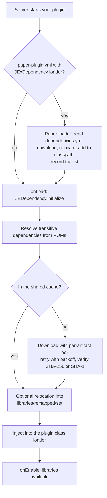

<div align="center">

# JExDependency

**Runtime dependency loading for Minecraft plugins on Spigot, Paper and Folia.**
Stop shading Hibernate, Jackson or JDBC drivers into your plugin jar. Declare them, and the server downloads,
verifies, optionally relocates and loads them at startup.

[](https://github.com/JExcellence/JExDependency/actions/workflows/ci.yml)
[](https://jitpack.io/#JExcellence/JExDependency)
[](LICENSE)
[](https://adoptium.net/)

[Quick start](#quick-start) · [How it works](#how-it-works) · [Paper plugins](#paper-plugins) · [Shading guide](#shading-jexdependency-into-your-plugin) · [Configuration](#configuration) · [Troubleshooting](#troubleshooting) · [Roadmap](ROADMAP.md)

</div>

---

## Is this for you?

You probably want JExDependency if one of these sounds familiar:

- Your plugin jar is 15 MB because it shades a database driver, an ORM or a JSON library.
- Another plugin updated Guava, Gson or Caffeine and yours now fails with `NoSuchMethodError` or
  `NoClassDefFoundError`.
- You use Spigot's `libraries:` block but need a library that is not on Maven Central, or you need to relocate it.
- You maintain several plugins on one network and every one of them downloads and stores the same libraries.

What you get:

- **Small plugin jars.** Only JExDependency (about 120 KB) and ASM are inside your jar; everything else is
  downloaded once per server.
- **One shared cache per server.** Plugins using JExDependency share downloads. Parallel startups never download the
  same file twice, and a partially written file is never used.
- **Transitive resolution.** Dependencies declared in each library's POM are resolved for you.
- **Optional relocation.** Rename library packages at runtime, the same result as Shadow's `relocate`, so your
  copy of a library cannot clash with another plugin's copy.
- **Paper plugin loader support.** On Paper, libraries can be on the classpath before your plugin class loads.
- **Failure policy.** Decide whether a missing library stops the plugin, is skipped, or goes to your callback.

## Quick start

**1. Add the library** (built by [JitPack](https://jitpack.io/#JExcellence/JExDependency); newer versions are listed under
[releases](https://github.com/JExcellence/JExDependency/releases)):

```kotlin
repositories {
    maven("https://jitpack.io")
}

dependencies {
    implementation("com.github.JExcellence:JExDependency:3.0.0")
    compileOnly("com.github.ben-manes.caffeine:caffeine:3.2.2") // downloaded at runtime, not shaded
}
```

<details>
<summary>Maven</summary>

```xml
<repositories>
    <repository>
        <id>jitpack.io</id>
        <url>https://jitpack.io</url>
    </repository>
</repositories>

<dependency>
    <groupId>com.github.JExcellence</groupId>
    <artifactId>JExDependency</artifactId>
    <version>3.0.0</version>
</dependency>
```

</details>

**2. List your runtime libraries** in `src/main/resources/dependency/dependencies.yml`:

```yaml
dependencies:
  - "com.github.ben-manes.caffeine:caffeine:3.2.2"
  - "com.fasterxml.jackson.core:jackson-databind:2.18.2"
  - "com.mysql:mysql-connector-j:9.2.0"
```

Libraries that are not on Maven Central need their repository. List it once, or pin a single library to it:

```yaml
repositories:
  - https://repo.example.org/releases
dependencies:
  - "com.example:tool:1.4.0"
  - "com.example:internal:2.0.0 @ https://repo.example.org/private"
  - "com.example:audited:1.0.0 sha256=<64 hex characters>"
```

A pinned library (`@ url`) is downloaded only from that repository. A `sha256=` value makes JExDependency accept
only that exact jar, from any repository and from the cache. Earlier versions also searched JitPack, PaperMC and
other community repositories for every library; set `community-repositories: true` in the file to keep that
behaviour.

**3. Load them in `onLoad()`:**

```java
public final class ExamplePlugin extends JavaPlugin {
    @Override
    public void onLoad() {
        JEDependency.initialize(this, ExamplePlugin.class);
    }
}
```

The libraries are on your plugin's classpath when `onEnable()` runs. Shade and relocate JExDependency itself as
shown in the [shading guide](#shading-jexdependency-into-your-plugin).

## How it works



| Entry point | Blocks `onLoad` | Use it when |
|---|:---:|---|
| `JEDependency.initialize(plugin, anchor)` | yes | Default. |
| `JEDependency.initializeWithRemapping(plugin, anchor)` | yes | You want relocated libraries (see [relocation](#relocation)). |
| `JEDependency.loadAsync(plugin, anchor)` | no | Startup should continue. Returns a `CompletableFuture<LoadResult>` with what was loaded and what failed; `JEDependency.whenLoaded(plugin, future, action)` continues on the server thread, on Folia on the global region scheduler. |
| `JEDependency.initializeAsync(plugin, anchor)` | no | Older form of `loadAsync` without a result. |

Each method also accepts a `String[]` of extra coordinates (`group:artifact:version[:classifier]`).
A platform-specific list in `dependency/paper/dependencies.yml` or `dependency/spigot/dependencies.yml` replaces
the main list on that platform; it is not merged with it.

Every startup logs one line such as `Loaded 12 libraries (3 transitive) in 840 ms: resolve 120 ms, download 600 ms
(9 cached, 3 downloaded), inject 40 ms`, so you can see what loading costs and whether the cache works.

## Compatibility

| | Status |
|---|---|
| Java | 21 or newer. CI builds and tests on Java 21 and 25. |
| Paper | Used in production on Paper 26.x. |
| Spigot, Folia | Supported by design. Automated tests on real servers are [planned](ROADMAP.md). |
| Libraries you load | Must run on the server's Java version: a Java 25 library will not load on a Java 21 server. |

## Paper plugins

With a `paper-plugin.yml`, Paper runs the JExDependency loader before your plugin class is loaded:

```yaml
name: ExamplePlugin
version: 1.0.0
main: com.example.ExamplePlugin
api-version: "1.21"
loader: de.jexcellence.dependency.loader.PaperPluginLoader
```

If you relocate JExDependency, use the relocated class name, for example
`com.example.libs.jexdependency.loader.PaperPluginLoader`. Still call `JEDependency.initialize(...)` in `onLoad()`:
it injects exactly the jars the loader recorded and, when the loader loaded everything (transitive dependencies
included, unless `-Djedependency.transitive=false`), does nothing else. Otherwise it resolves what is missing.

## Relocation

Relocation renames a library's packages (`com.google.gson` becomes `com.example.myplugin.libs.com.google.gson`)
so your copy cannot collide with another plugin's copy. It only works when your own classes use the relocated
names too, so JExDependency relocates exactly the libraries your compiled plugin already refers to under the
prefix. Keep the library `compileOnly` and the `relocate(...)` line in Shadow:

```kotlin
tasks.shadowJar {
    relocate("com.google.gson", "com.example.myplugin.libs.com.google.gson")
}
```

```yaml
relocation-prefix: com.example.myplugin.libs
dependencies:
  - "com.google.code.gson:gson:2.13.1"
```

At startup the plugin jar is scanned; gson is referenced under the prefix, so the whole gson jar is relocated.
Libraries your code uses by their original names stay as they are. This works the same in the Paper loader
(on by default, `jedependency.remap=auto`) and with `JEDependency.initializeWithRemapping` on Spigot.

- `relocations:` in `dependencies.yml` (`- com.google.gson => my.libs.gson`) or `-Djedependency.relocations` set
  explicit relocations instead.
- `relocation-excludes:` lists packages that are never relocated. JDK, Jakarta and XML API packages are always
  excluded.
- Use a prefix of your own: two plugins that relocate into the same prefix share those classes again.
- On Paper, every plugin with a `paper-plugin.yml` has its own class loader, so relocation is rarely needed there.

Relocated copies are stored per relocation set in `plugins/<YourPlugin>/libraries/remapped/<set>/`, so changing
your libraries or the relocation settings always produces fresh copies.

## Shading JExDependency into your plugin

Relocate JExDependency and ASM into your own package. On Spigot, plugin class loaders can see each other's classes,
so two plugins that ship different JExDependency versions under the same package can load the wrong one.

```kotlin
plugins {
    id("com.gradleup.shadow") version "9.4.0"
}

tasks.shadowJar {
    relocate("de.jexcellence.dependency", "com.example.libs.jexdependency")
    relocate("org.objectweb.asm", "com.example.libs.asm")
}
```

**Moving away from shading libraries:** change each shaded library from `implementation` to `compileOnly`, list it
in `dependency/dependencies.yml`, delete its `relocate(...)` line, and keep only the two relocations above.

## Configuration

Server owners can change behaviour with JVM system properties, without rebuilding any plugin.

| Property | Default | Effect |
|---|---|---|
| `jedependency.remap` | `auto` in the Paper loader, otherwise off | `true`, `1`, `yes` or `on` turns relocation on; `false` turns it off. |
| `jedependency.relocations` | none | Explicit relocations: `com.google.gson=>my.libs.gson,org.foo=>my.libs.foo`. |
| `jedependency.relocations.prefix` | `de.jexcellence.remapped` | Package prefix for automatic relocation when the plugin sets no `relocation-prefix:`. |
| `jedependency.relocations.excludes` | none | Comma-separated packages that are never relocated, added to the plugin's `relocation-excludes:`. |
| `jedependency.transitive` | `true` | `false` stops the Paper loader from downloading the dependencies of your libraries. |
| `jedependency.repository.community` | `false` | `true` searches the built-in community repositories (NeetGames, JitPack, Auxilor, Tcoded, PaperMC, SpigotMC, Gradle plugins) after Central for every plugin. |
| `jedependency.repository.central` | Google's Central mirror | Maven Central mirror to download from, for example your own Nexus. Falls back to the `PAPER_DEFAULT_CENTRAL_REPOSITORY` environment variable. Set it to `https://repo1.maven.org/maven2` to download from Central directly. Read once at startup. |
| `jedependency.cache.dir` | `<server>/.jexdependency/cache` | Location of the shared cache, for example a Docker volume. |
| `jedependency.path.default` | `/dependency/dependencies.yml` | Resource path of the main dependency list. |
| `jedependency.path.paper` | `/dependency/paper/dependencies.yml` | Resource path of the Paper-only list. |
| `jedependency.path.spigot` | `/dependency/spigot/dependencies.yml` | Resource path of the Spigot-only list. |

Example: `java -Djedependency.cache.dir=/data/jexdependency -jar paper.jar`

**Private repositories.** Credentials never go into `dependencies.yml` or a plugin jar. Set an environment
variable on the server named `JEDEPENDENCY_AUTH_` plus the repository host in upper case with every other
character replaced by `_`, for example `JEDEPENDENCY_AUTH_REPO_EXAMPLE_ORG=deploy:password` or
`JEDEPENDENCY_AUTH_REPO_EXAMPLE_ORG=Bearer <token>`. Credentials are sent only over HTTPS and only to that host.

### Failure policy

```java
new DependencyManager(this, ExamplePlugin.class)
        .setFailurePolicy(FailurePolicy.DEGRADED)
        .initialize(null);
```

| Policy | When a library cannot be loaded |
|---|---|
| `STRICT` | Startup fails with an exception. |
| `DEGRADED` | The library is skipped and logged; the plugin continues. |
| `CALLBACK` | Your `FailureCallback` decides. |

## Where files go

```
<server>/.jexdependency/cache/                  shared by all plugins
  cache-format.properties                       cache layout version
  jars/<group path>/<artifact>/<version>/...    downloaded libraries
  poms/...                                      POMs for transitive resolution
  locks/                                        one empty lock file per artifact
plugins/<YourPlugin>/libraries/remapped/<set>/  relocated copies, one folder per relocation set
plugins/<YourPlugin>/libraries/paper-loader-classpath.txt   jars the Paper loader added
```

While the server is stopped you can delete the whole cache (it is downloaded again) and any folder in
`libraries/remapped/` (relocation sets that are no longer used are never loaded). Jars in the old per-plugin
`plugins/<YourPlugin>/libraries/` folder are copied into the shared cache automatically.

## Network and security

JExDependency downloads code that runs with your plugin's rights. Here is exactly what it does:

- **When:** only at startup, only for jars and POMs that are not cached yet.
- **Where from:** a Maven Central mirror first (Google's, the same default Paper uses), then Maven Central itself,
  then the repositories your `dependencies.yml` lists. Community repositories (JitPack, PaperMC and others) are
  searched only when the plugin or the server turns them on. A library pinned with `@ url` comes only from that
  repository. Maven Central's terms do not allow using it as a download CDN, which is why the mirror comes first;
  set `jedependency.repository.central` or Paper's `PAPER_DEFAULT_CENTRAL_REPOSITORY` to use your own mirror.
- **How:** one HTTP/2 connection per host, at most six parallel requests per host, retries with backoff on
  timeouts, rate limits (honouring `Retry-After`) and server errors. Redirects from HTTPS to HTTP are refused.
- **Verification:** a `sha256=` value in `dependencies.yml` must match. Otherwise the repository's `.sha256` file
  is used, then its `.sha1` file; a mismatch rejects the jar. A repository without checksums is trusted as is.
  Every download must also open as a jar, so HTML error pages never reach the cache.
- **Versions:** pin exact versions; version ranges are not resolved.

Report vulnerabilities privately as described in [SECURITY.md](SECURITY.md).

## Troubleshooting

| Symptom | Cause and fix |
|---|---|
| `UnsupportedClassVersionError` | A library needs a newer Java than the server runs. Use an older library version or a newer Java. |
| `NoClassDefFoundError` for a library class | The library is missing from `dependencies.yml`, or the code ran before async initialization finished. |
| `NoSuchMethodError` in a library | Another plugin's copy of the same library was loaded first. Relocate (see [Relocation](#relocation)). |
| `InaccessibleObjectException` mentioning `java.net` | Class loader injection was blocked. Start the server with `--add-opens java.base/java.net=ALL-UNNAMED`. |
| "Network unreachable and no cached artifact available" | No internet access. Copy the cache from a machine that has it, or point `jedependency.cache.dir` to a filled cache. |
| Two plugins load different JExDependency versions | At least one plugin does not relocate JExDependency. See the [shading guide](#shading-jexdependency-into-your-plugin). |

Turn on `FINE` logging for the `JExDependency` logger to see every download, checksum check and relocation.

## Alternatives

| | Spigot `libraries:` | Paper `PluginLoader` | Shading | JExDependency |
|---|:---:|:---:|:---:|:---:|
| Works on Spigot | 1.16.5+ | no | yes | yes |
| Works on Paper | yes | yes | yes | yes |
| Repositories besides Maven Central | no | yes | n/a | yes, declared in `dependencies.yml` |
| Package relocation | no | no | yes | yes |
| Small plugin jar | yes | yes | no | yes |

[libby](https://github.com/AlessioDP/libby) solves a similar problem with a code-first API across more platforms;
compare both if you also target proxies.

## Roadmap and contributing

Planned work, from opt-in community repositories to build-time lockfiles and parallel resolution, is in
[ROADMAP.md](ROADMAP.md). Items marked **help wanted** are good first contributions; read
[CONTRIBUTING.md](CONTRIBUTING.md) first.

```bash
./gradlew build   # JDK 21+; compiles, runs the tests and builds the Javadoc
```

Questions and ideas: [GitHub Issues](https://github.com/JExcellence/JExDependency/issues), email
[justin.eiletz@jexcellence.de](mailto:justin.eiletz@jexcellence.de) or Discord
[`jexcellence`](https://discord.com/users/jexcellence).

## License

[MIT](LICENSE)
